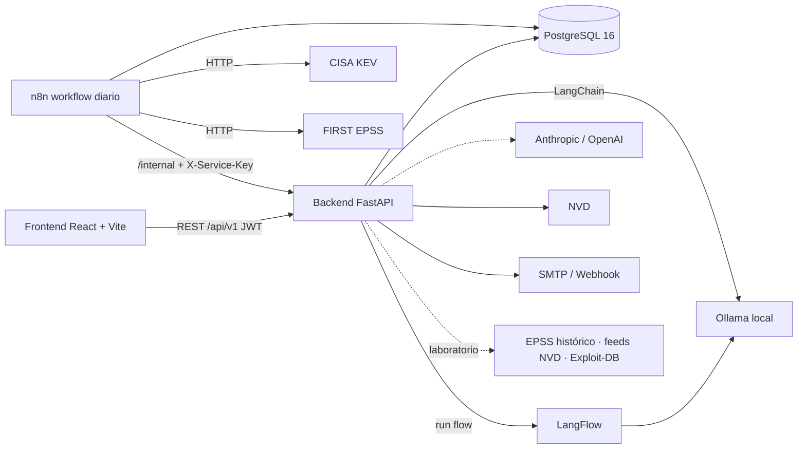

# Radar de explotación activa (KEV/EPSS)

Cruza **cada día** el inventario propio de activos con el catálogo **KEV de CISA** (vulnerabilidades explotadas activamente) y los scores **EPSS de FIRST**, para parchear primero el ~5 % de CVEs que sí se explotan. Responde al *Caso 08* (NIST CSF **ID.RA-1**).

- **Detección determinista** (sin IA): descarga de KEV y EPSS, cruce con pandas y decisión de "nueva entrada KEV en mi entorno".
- **IA opcional** (Ollama local por defecto, Anthropic u OpenAI desde `.env`): enriquece tickets, responde consultas en lenguaje natural y redacta el resumen ejecutivo. Todo lo generado va marcado y queda en la bitácora.
- **Operación**: alertas urgentes (app + correo + webhook), tickets de remediación con SLA, dashboard y reportes en PDF, Word y Excel.
- **Laboratorio de modelos** (experimental, aparte de la detección): entrena y evalúa modelos que anticipan qué CVE entrarán a KEV.

## Arquitectura



Tres bases aisladas en un solo PostgreSQL (`radar`, `n8n`, `langflow`), cada una con su propio rol: n8n **no** puede leer la base de la app.

## Requisitos

- Docker Desktop (Compose v2) con ≥ 8 GB de RAM asignados. Para IA local: ~3 GB libres en disco para el modelo y, opcionalmente, una GPU NVIDIA.
- Node 22+ solo si va a desarrollar el frontend fuera de Docker. Python se ejecuta dentro del contenedor (3.12).

## Instalación

```bash
git clone <este repositorio> && cd <carpeta>
sh scripts/gen-secrets.sh            # Windows (PowerShell): powershell -File scripts/gen-secrets.ps1
docker compose up -d --build
```

`gen-secrets` crea `.env` desde `.env.example` con secretos aleatorios (no sobrescribe un `.env` existente). Al arrancar se aplican las migraciones, se siembran roles, usuarios y datos de demostración, y —con `COMPOSE_PROFILES=ollama`— se descarga el modelo de IA (la primera vez tarda unos minutos).

| Servicio | URL | Nota |
|---|---|---|
| **Aplicación** | http://localhost:8080 | único servicio expuesto a la red |
| API (Swagger) | http://localhost:8000/docs | solo en este equipo; en producción se desactiva |
| n8n | http://localhost:5678 | solo este equipo |
| LangFlow | http://localhost:7860 | solo este equipo (usuario/clave: `LANGFLOW_SUPERUSER*` del `.env`) |
| Mailpit (correos de prueba) | http://localhost:8025 | solo este equipo |

### Cargar datos reales de CISA y FIRST

El flujo diario lo hace n8n: lo intenta cada hora entre las 06:00 y las 18:00 (hora de Lima) y corre una sola vez al día
(las siguientes se omiten). Así, si el equipo estaba apagado a las 06:00, se pone al día en cuanto se enciende. Para hacerlo ahora: botón **Ejecutar ahora** en *Ejecuciones*, o

```bash
docker compose exec backend python -m app.refresh
```

### Credenciales semilla (solo demostración)

Todas usan la contraseña de `SEED_DEMO_PASSWORD` en `.env` (por defecto `Radar-Demo-2026!`). **Cámbielas antes de cualquier uso real** (desactive `SEED_ON_START`).

| Usuario | Rol | Ve |
|---|---|---|
| `admin@radar.local` | Administrador | todo, usuarios, roles y configuración |
| `analista@radar.local` | Analista de vulnerabilidades | activos, importación, vulnerabilidades, tickets, reportes, IA |
| `auditor@radar.local` | Auditor | solo lectura de todo + bitácora y uso de IA |
| `gerencia@radar.local` | Gerencia | dashboard, KEV, tickets (lectura), reportes e IA agregada |

## Importar el workflow de n8n

Se importa y publica **solo** al levantar (servicio `n8n-import`). Detalles, diseño nodo por nodo e importación manual en [`n8n/README.md`](n8n/README.md). Tras editar un JSON de `n8n/workflows/`:

```bash
docker compose up -d --force-recreate n8n-import
```

## IA

Por defecto: **Ollama local** con `qwen2.5:3b` (`LLM_PROVIDER=ollama`).

- **GPU NVIDIA**: en `.env`, `COMPOSE_FILE=docker-compose.yml:docker-compose.gpu.yml` (y `COMPOSE_PATH_SEPARATOR=:` en Windows).
- **Anthropic u OpenAI**: `LLM_PROVIDER=anthropic|openai`, `LLM_MODEL=<modelo>` y la clave (`ANTHROPIC_API_KEY` / `OPENAI_API_KEY`); quite `ollama` de `COMPOSE_PROFILES`.
- **Sin IA**: `LLM_PROVIDER=none`. La detección, las alertas, los tickets y los reportes siguen funcionando; solo se desactiva lo generado.

Garantías: el modelo solo responde con datos recuperados de la base (no hay texto-a-SQL; el asistente llama a 7 herramientas de solo lectura con tus permisos), un CVE, equipo o URL que no esté en las fuentes invalida la respuesta, los textos de CISA/NVD se tratan como datos no confiables y cada llamada queda registrada (usuario, prompt, fuentes, modelo, tokens, latencia).

El flow de enriquecimiento está en [`langflow/flows/ticket_enrichment.json`](langflow/flows/ticket_enrichment.json) y se carga solo; el backend lo ejecuta por la API de LangFlow y, si falla, usa la misma lógica con LangChain.

## Score de riesgo y SLA

Fórmula explícita y editable en *Configuración* (cada cambio crea una versión y recalcula; los hallazgos ya cerrados no se recalculan):

```
base = w_epss·EPSS + w_percentil·percentil + w_cvss·(CVSS/10) + w_activo·(criticidad/4)
en KEV:       score = piso + (100 − piso)·base (+ bono si hay uso en ransomware), tope 100
fuera de KEV: score = (piso − 1)·base          → un CVE en KEV siempre supera a uno que no lo está
```

SLA en KEV: el `dueDate` de CISA (si se detectó después, la misma ventana desde la detección); fuera de KEV: días por banda (15/30/90/180).

## Análisis estadístico

Todo se calcula en el backend con pandas/numpy (sin modelos entrenados: esos están aparte, en el
[Laboratorio de modelos](#laboratorio-de-modelos-experimental)) y cada tabla o figura trae su lectura en español («Cómo leerla»).

| Dónde | Qué responde | API |
|---|---|---|
| Resumen → Perfil del inventario | Estadística descriptiva de score, EPSS y CVSS (mediana, cuartiles, P90, tramos), por criticidad y entorno, y KEV frente al resto | `GET /dashboard/descriptive` |
| Resumen → Calidad de los datos | Criticidad supuesta, faltantes, EPSS desactualizado, grupos pequeños o dominantes | (incluido en el anterior) |
| Resumen → ¿Qué criterio encuentra lo que ya explotan? | CVSS, EPSS y score sin KEV frente a KEV en el inventario: AUC con IC 95 %, curvas ROC y precisión-cobertura, matrices de confusión | `GET /dashboard/evaluation` |
| Resumen → ¿EPSS anticipa lo que entrará a KEV? | Prueba prospectiva sobre todo el universo de CVE: el EPSS de hace 30/90/180 días frente a lo que entró a KEV después | `GET/POST /dashboard/evaluation/universe` |
| Configuración → Sensibilidad | Cuánto cambia la prioridad si cambian los pesos: N combinaciones al azar, parecido al orden vigente, cambios de banda, importancia de cada peso | `POST /settings/scoring/sensitivity` |
| Resumen → ¿Mejoramos de verdad? | Periodo actual frente al anterior: Mann-Whitney (MTTR), dos proporciones (SLA), Mann-Kendall (tendencia) | `GET /dashboard/comparison` |

El score completo nunca se evalúa contra KEV (incluye KEV: daría un resultado perfecto por construcción). Reportes
analíticos en PDF, Word (figuras a 600 DPI) y Excel: *Perfil del inventario*, *Evaluación de criterios frente a KEV* y
*Prueba prospectiva de EPSS* (esta última necesita un cálculo guardado).

## Laboratorio de modelos (experimental)

Menú *Laboratorio*. Entrena modelos para una pregunta concreta: **¿qué CVE que hoy no están en KEV entrarán en los
próximos N días?** (clasificación binaria). Es un módulo de análisis aparte: **nunca** cambia la detección, el score
ni las alertas del radar. Sigue las fases del Promptuario del curso:

| Fase | Qué hace | Dónde |
|---|---|---|
| 1 · Datos | Construye el dataset a partir de fuentes públicas, valida, describe las variables y guarda la procedencia (URL, fecha, SHA-256, licencia) | `ml/dataset.py`, `ml/profile.py` |
| 2 · Entrenamiento | Regresión logística, random forest y gradient boosting con validación cruzada anidada **temporal con embargo** (4×2 en datasets nuevos; 5×3 en los heredados) y Optuna (TPE con semilla, poda por mediana); ablación sin EPSS, sin CVSS o sin versión de EPSS | `ml/training.py` |
| 3 · Evaluación | En prueba: PR-AUC, ROC-AUC, matrices de confusión, curvas, bootstrap pareado, McNemar, Friedman y estabilidad por mes | `ml/assess.py` |
| 4 · Explicabilidad | Equivalentes tabulares de Grad-CAM++ (oclusión), mapas de atención (permutación, dependencia parcial 1D/2D) y máscaras caso por caso | `ml/explain.py` |
| 5 · Reportes | Dataset, entrenamiento, evaluación y explicabilidad en PDF, Word (600 DPI) y Excel | `services/reports/lab.py` |
| 6 · Inferencia | Predicción de un CVE (del dataset o con valores a mano): probabilidad calibrada con IC 90 %, severidad y explicación | `ml/inference.py` |
| 7 · Optimización | Estudios de Optuna configurables (espacio, muestreador, poda, pruebas, tiempo), monitoreo en vivo, importancia fANOVA y avisos de rango | `ml/optimize.py` |

**Datos.** Una fila es un CVE que aún no estaba en KEV en una foto mensual S; la etiqueta es si entró a KEV en (S, S+N].
Fuentes: EPSS histórico diario de FIRST, KEV (tabla del radar), feeds 2.0 del NVD por año y `files_exploits.csv` de
Exploit-DB. Solo se usan variables conocidas **en la fecha de la foto** (EPSS y su cambio, CVSS y CWE puestos por la
propia CNA, antigüedad del CVE, exploits públicos con fecha anterior, KEV previos de la misma CNA). Se descartaron por
fuga de información SSVC de CISA, el CVSS/CWE del NVD o de terceros, el número de referencias y Metasploit. La partición
es temporal 70/15/15 por fotos (el futuro nunca predice el pasado); los negativos se muestrean con su peso (1/tasa).
El modelo se **elige en validación** y se **informa en prueba**.

**Uso.** La primera construcción descarga unos 290 MB (se guardan en el volumen `ml_data` y se reutilizan; con la caché,
un dataset se arma en unos 3 minutos). Entrenar tarda de minutos (logística) a cerca de una hora (gradient boosting con
15 pruebas). Los trabajos corren en segundo plano con su progreso en pantalla; **no reinicie el backend mientras
entrena** (el trabajo queda «interrumpido»). Permisos `ml:view` (ver, predecir) y `ml:create` (construir, entrenar,
lanzar estudios); la API está en `/api/v1/ml/*` y cada acción queda en la bitácora.

**Resultados con datos reales** (20 fotos de ene-2025 a ago-2026, horizonte de 90 días, 301 167 filas y 602 entradas a
KEV; prueba = jun a ago-2026 con 93 entradas):

| Modelo | PR-AUC prueba | ROC-AUC prueba | Revisando el 1 % cubre |
|---|---|---|---|
| Random forest | 0,0178 | 0,914 | 42 % |
| Regresión logística | 0,0115 | 0,920 | 37 % |
| Gradient boosting (elegido en validación) | 0,0017 | 0,852 | 34 % |
| EPSS solo, sin entrenar | 0,0006 | 0,637 | — |

- Los modelos entrenados superan con holgura a EPSS solo, pero la prevalencia es de ~0,01 %: incluso el mejor acierta
  pocas veces en términos absolutos. Sirven para ordenar, no como alarma.
- El gradient boosting gana en validación y cae en prueba en los tres meses: generaliza peor a meses nuevos. Es el
  ejemplo de por qué no se elige mirando la prueba.
- Calibradas en validación, todas las probabilidades **sobreestiman** en prueba (en los cinco primeros modelos entra
  entre el 50 % y el 80 % de lo esperado; en la logística reentrenada, el 12 %): hay deriva entre meses y conviene
  recalibrar con datos recientes.
- Optuna: en la logística, `class_weight` explica el 90 % de la variación; reentrenarla con un rango de C más amplio
  empeoró el resultado (con tan pocos positivos, la regularización fuerte generaliza mejor).

## Pruebas

```bash
docker compose run --rm backend pytest              # unos 270 tests, ~6 min (crea esquemas temporales; no toca los datos)
docker compose run --rm backend sh -c "ruff check . && mypy app"
cd frontend && npm ci && npm run lint && npm run typecheck && npm test && npm run build
```

Los tests de IA usan modelos simulados (nunca llaman a un LLM real) y los del laboratorio, fuentes sintéticas (no descargan nada). Los tests de backend necesitan la base de datos del `docker compose`.

## Seguridad (resumen)

- JWT de acceso de 15 min en memoria; refresh de 7 días en cookie `httpOnly` + `SameSite=Strict` con rotación y detección de reutilización. Argon2, política de contraseñas y bloqueo tras 5 intentos; límite de uso por cliente real (login 5/min).
- RBAC `módulo:acción` validado **siempre en el servidor** (el frontend solo oculta).
- Bitácora **solo de añadir** (trigger de PostgreSQL + hash SHA-256 encadenado con verificación).
- Archivos subidos validados por tipo, tamaño y contenido; XML con `defusedxml` (sin XXE). Reportes: texto externo escapado (HTML y fórmulas de Excel).
- CSP, cabeceras de seguridad, CORS restringido, errores sin detalles internos y validación sin eco de valores. Solo el frontend se publica a la red.
- Secretos solo en `.env` (fuera de git); la configuración de integraciones se guarda cifrada (Fernet). El backend **no arranca** con secretos ausentes o de ejemplo.
- Dependencias: `pip-audit` y `npm audit --omit=dev` sin vulnerabilidades. (`npm audit` completo marca avisos *moderados* solo en herramientas de desarrollo —`eslint`/`minimatch`—, que no se despliegan.)

**Para producción**: ponga TLS delante (y active HSTS en `frontend/nginx.conf`), `ENVIRONMENT=production`, cambie o elimine los usuarios semilla y no publique los puertos auxiliares.

## Estructura

```
backend/        FastAPI (api/, services/ [cruce, score, reportes], ai/, ml/ [laboratorio], models/, alembic/, tests/)
frontend/       React + Vite + TypeScript + Tailwind v4
n8n/            workflows versionados y script de importación
langflow/flows/ flow de enriquecimiento de tickets
samples/        hallazgos de ejemplo (CSV y .nessus)
infra/          inicialización de PostgreSQL (3 bases)
.claude/skills/ skills de diseño del proyecto
```

`CLAUDE.md` resume comandos, convenciones y decisiones para futuras sesiones de trabajo.

## Solución de problemas

| Síntoma | Causa / solución |
|---|---|
| El backend no arranca: "Configuración insegura" | Falta o es de ejemplo un secreto: ejecute `scripts/gen-secrets` (o corrija `.env`). |
| El asistente dice que la IA no está disponible | Ollama aún descarga el modelo (`docker compose logs ollama-pull`) o `LLM_PROVIDER=none`. El resto del sistema sigue funcionando. |
| Un ticket quedó "sin enriquecer" y la ejecución dice "con avisos" | Es el comportamiento previsto si la IA falla o es descartada por no estar respaldada en las fuentes; regenere desde el ticket. |
| `.env` con variables que parecen tener texto raro | No ponga comentarios en la misma línea de una variable vacía; Compose los toma como valor. |
| LangFlow devuelve 403 tras recrearlo | Mantenga fijo `LANGFLOW_SECRET_KEY`; si cambió, reinicie el backend. |
| Error al subir el `.sh` en Windows (`illegal option -`) | Finales de línea CRLF; el repositorio fuerza LF para `*.sh` (`.gitattributes`). |
| Un entrenamiento o estudio del laboratorio aparece «Interrumpido por un reinicio» | Se reinició el backend mientras corría (los trabajos viven en el proceso). Vuelva a lanzarlo. |
| Evaluación, explicabilidad o reporte del laboratorio dicen «calculando» o piden calcular | Se calculan una vez en segundo plano (minutos) y quedan en caché; los reportes de las fases 3 y 4 piden calcularlas antes. |

## Limitaciones conocidas

- Con los pesos por defecto, el score de los CVEs en KEV tiende a saturar entre 92 y 100 (ajustable en *Configuración*).
- Un modelo local de 3B es modesto: los controles detectan datos inventados (CVE, equipos, URLs) pero no toda imprecisión semántica; revise lo generado. Para más calidad use un modelo mayor o Anthropic/OpenAI.
- La bitácora se protege con trigger y hash encadenado, pero el rol de la app es dueño de la tabla y podría quitar el trigger (mejora futura: rol de solo inserción).
- PostgreSQL 16 es requisito del proyecto; n8n 3.x lo marca como "compatibilidad" (funciona).
- Laboratorio: los datasets construidos antes del protocolo con embargo (fotos desde 2025-01 sin exclusión) tienen la validación contaminada por etiquetas que miran hacia el bloque siguiente (auditoría en `articulo/protocolo/F1_auditoria.md`); los nuevos excluyen esas fotos. Los «positivos por mes» son filas: un mismo CVE aparece en hasta 3 fotos, por eso se informan también los eventos únicos.
- Laboratorio: con 24 a 37 entradas a KEV por mes, las cifras mensuales son ruidosas y los intervalos, anchos. Los modelos se entrenan con meses hasta ago-2026 y no se reentrenan solos; con el tiempo hay que reconstruir el dataset y reentrenar.
