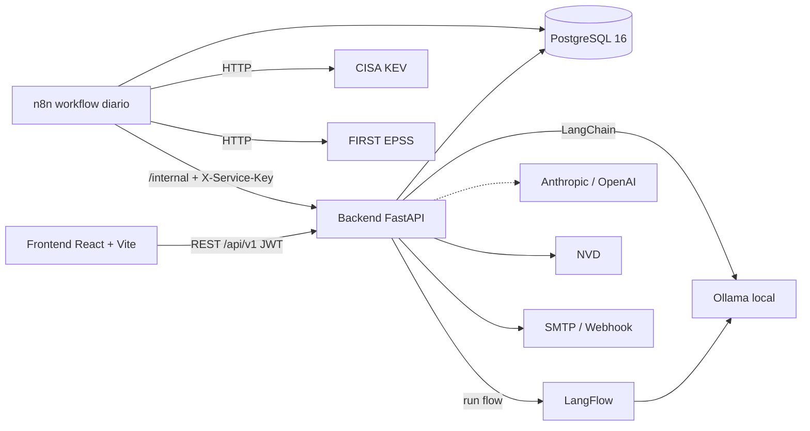

# Radar de explotación activa (KEV/EPSS)

Cruza **cada día** el inventario propio de activos con el catálogo **KEV de CISA** (vulnerabilidades explotadas activamente) y los scores **EPSS de FIRST**, para parchear primero el ~5 % de CVEs que sí se explotan. Responde al *Caso 08* (NIST CSF **ID.RA-1**).

- **Detección determinista** (sin IA): descarga de KEV y EPSS, cruce con pandas y decisión de "nueva entrada KEV en mi entorno".
- **IA opcional** (Ollama local por defecto, Anthropic u OpenAI desde `.env`): enriquece tickets, responde consultas en lenguaje natural y redacta el resumen ejecutivo. Todo lo generado va marcado y queda en la bitácora.
- **Operación**: alertas urgentes (app + correo + webhook), tickets de remediación con SLA, dashboard y reportes en PDF, Word y Excel.

## Arquitectura



Tres bases aisladas en un solo PostgreSQL (`radar`, `n8n`, `langflow`), cada una con su propio rol: n8n **no** puede leer la base de la app.

## Requisitos

- Docker Desktop (Compose v2) con ≥ 8 GB de RAM asignados. Para IA local: ~3 GB libres en disco para el modelo y, opcionalmente, una GPU NVIDIA.
- Node 22+ solo si va a desarrollar el frontend fuera de Docker. Python se ejecuta dentro del contenedor (3.12).

## Instalación

```bash
git clone <este repositorio> && cd <carpeta>
sh scripts/gen-secrets.sh            # Windows (PowerShell): powershell -File scripts/gen-secrets.ps1
docker compose up -d --build
```

`gen-secrets` crea `.env` desde `.env.example` con secretos aleatorios (no sobrescribe un `.env` existente). Al arrancar se aplican las migraciones, se siembran roles, usuarios y datos de demostración, y —con `COMPOSE_PROFILES=ollama`— se descarga el modelo de IA (la primera vez tarda unos minutos).

| Servicio | URL | Nota |
|---|---|---|
| **Aplicación** | http://localhost:8080 | único servicio expuesto a la red |
| API (Swagger) | http://localhost:8000/docs | solo en este equipo; en producción se desactiva |
| n8n | http://localhost:5678 | solo este equipo |
| LangFlow | http://localhost:7860 | solo este equipo (usuario/clave: `LANGFLOW_SUPERUSER*` del `.env`) |
| Mailpit (correos de prueba) | http://localhost:8025 | solo este equipo |

### Cargar datos reales de CISA y FIRST

El flujo diario lo hace n8n a las 06:00 (hora de Lima). Para hacerlo ahora: botón **Ejecutar ahora** en *Ejecuciones*, o

```bash
docker compose exec backend python -m app.refresh
```

### Credenciales semilla (solo demostración)

Todas usan la contraseña de `SEED_DEMO_PASSWORD` en `.env` (por defecto `Radar-Demo-2026!`). **Cámbielas antes de cualquier uso real** (desactive `SEED_ON_START`).

| Usuario | Rol | Ve |
|---|---|---|
| `admin@radar.local` | Administrador | todo, usuarios, roles y configuración |
| `analista@radar.local` | Analista de vulnerabilidades | activos, importación, vulnerabilidades, tickets, reportes, IA |
| `auditor@radar.local` | Auditor | solo lectura de todo + bitácora y uso de IA |
| `gerencia@radar.local` | Gerencia | dashboard, KEV, tickets (lectura), reportes e IA agregada |

## Importar el workflow de n8n

Se importa y publica **solo** al levantar (servicio `n8n-import`). Detalles, diseño nodo por nodo e importación manual en [`n8n/README.md`](n8n/README.md). Tras editar un JSON de `n8n/workflows/`:

```bash
docker compose up -d --force-recreate n8n-import
```

## IA

Por defecto: **Ollama local** con `qwen2.5:3b` (`LLM_PROVIDER=ollama`).

- **GPU NVIDIA**: en `.env`, `COMPOSE_FILE=docker-compose.yml:docker-compose.gpu.yml` (y `COMPOSE_PATH_SEPARATOR=:` en Windows).
- **Anthropic u OpenAI**: `LLM_PROVIDER=anthropic|openai`, `LLM_MODEL=<modelo>` y la clave (`ANTHROPIC_API_KEY` / `OPENAI_API_KEY`); quite `ollama` de `COMPOSE_PROFILES`.
- **Sin IA**: `LLM_PROVIDER=none`. La detección, las alertas, los tickets y los reportes siguen funcionando; solo se desactiva lo generado.

Garantías: el modelo solo responde con datos recuperados de la base (no hay texto-a-SQL; el asistente llama a 7 herramientas de solo lectura con tus permisos), un CVE, equipo o URL que no esté en las fuentes invalida la respuesta, los textos de CISA/NVD se tratan como datos no confiables y cada llamada queda registrada (usuario, prompt, fuentes, modelo, tokens, latencia).

El flow de enriquecimiento está en [`langflow/flows/ticket_enrichment.json`](langflow/flows/ticket_enrichment.json) y se carga solo; el backend lo ejecuta por la API de LangFlow y, si falla, usa la misma lógica con LangChain.

## Score de riesgo y SLA

Fórmula explícita y editable en *Configuración* (cada cambio crea una versión y recalcula; los hallazgos ya cerrados no se recalculan):

```
base = w_epss·EPSS + w_percentil·percentil + w_cvss·(CVSS/10) + w_activo·(criticidad/4)
en KEV:       score = piso + (100 − piso)·base (+ bono si hay uso en ransomware), tope 100
fuera de KEV: score = (piso − 1)·base          → un CVE en KEV siempre supera a uno que no lo está
```

SLA en KEV: el `dueDate` de CISA (si se detectó después, la misma ventana desde la detección); fuera de KEV: días por banda (15/30/90/180).

## Pruebas

```bash
docker compose run --rm backend pytest              # 190 tests (crea esquemas temporales; no toca los datos)
docker compose run --rm backend sh -c "ruff check . && mypy app"
cd frontend && npm ci && npm run lint && npm run typecheck && npm test && npm run build
```

Los tests de IA usan modelos simulados (nunca llaman a un LLM real). Los tests de backend necesitan la base de datos del `docker compose`.

## Seguridad (resumen)

- JWT de acceso de 15 min en memoria; refresh de 7 días en cookie `httpOnly` + `SameSite=Strict` con rotación y detección de reutilización. Argon2, política de contraseñas y bloqueo tras 5 intentos; límite de uso por cliente real (login 5/min).
- RBAC `módulo:acción` validado **siempre en el servidor** (el frontend solo oculta).
- Bitácora **solo de añadir** (trigger de PostgreSQL + hash SHA-256 encadenado con verificación).
- Archivos subidos validados por tipo, tamaño y contenido; XML con `defusedxml` (sin XXE). Reportes: texto externo escapado (HTML y fórmulas de Excel).
- CSP, cabeceras de seguridad, CORS restringido, errores sin detalles internos y validación sin eco de valores. Solo el frontend se publica a la red.
- Secretos solo en `.env` (fuera de git); la configuración de integraciones se guarda cifrada (Fernet). El backend **no arranca** con secretos ausentes o de ejemplo.
- Dependencias: `pip-audit` y `npm audit --omit=dev` sin vulnerabilidades. (`npm audit` completo marca avisos *moderados* solo en herramientas de desarrollo —`eslint`/`minimatch`—, que no se despliegan.)

**Para producción**: ponga TLS delante (y active HSTS en `frontend/nginx.conf`), `ENVIRONMENT=production`, cambie o elimine los usuarios semilla y no publique los puertos auxiliares.

## Estructura

```
backend/        FastAPI (api/, services/ [cruce, score, reportes], ai/, models/, alembic/, tests/)
frontend/       React + Vite + TypeScript + Tailwind v4
n8n/            workflows versionados y script de importación
langflow/flows/ flow de enriquecimiento de tickets
samples/        hallazgos de ejemplo (CSV y .nessus)
infra/          inicialización de PostgreSQL (3 bases)
.claude/skills/ skills de diseño del proyecto
```

`CLAUDE.md` resume comandos, convenciones y decisiones para futuras sesiones de trabajo.

## Solución de problemas

| Síntoma | Causa / solución |
|---|---|
| El backend no arranca: "Configuración insegura" | Falta o es de ejemplo un secreto: ejecute `scripts/gen-secrets` (o corrija `.env`). |
| El asistente dice que la IA no está disponible | Ollama aún descarga el modelo (`docker compose logs ollama-pull`) o `LLM_PROVIDER=none`. El resto del sistema sigue funcionando. |
| Un ticket quedó "sin enriquecer" y la ejecución dice "con avisos" | Es el comportamiento previsto si la IA falla o es descartada por no estar respaldada en las fuentes; regenere desde el ticket. |
| `.env` con variables que parecen tener texto raro | No ponga comentarios en la misma línea de una variable vacía; Compose los toma como valor. |
| LangFlow devuelve 403 tras recrearlo | Mantenga fijo `LANGFLOW_SECRET_KEY`; si cambió, reinicie el backend. |
| Error al subir el `.sh` en Windows (`illegal option -`) | Finales de línea CRLF; el repositorio fuerza LF para `*.sh` (`.gitattributes`). |

## Limitaciones conocidas

- Con los pesos por defecto, el score de los CVEs en KEV tiende a saturar entre 92 y 100 (ajustable en *Configuración*).
- Un modelo local de 3B es modesto: los controles detectan datos inventados (CVE, equipos, URLs) pero no toda imprecisión semántica; revise lo generado. Para más calidad use un modelo mayor o Anthropic/OpenAI.
- La bitácora se protege con trigger y hash encadenado, pero el rol de la app es dueño de la tabla y podría quitar el trigger (mejora futura: rol de solo inserción).
- PostgreSQL 16 es requisito del proyecto; n8n 3.x lo marca como "compatibilidad" (funciona).
